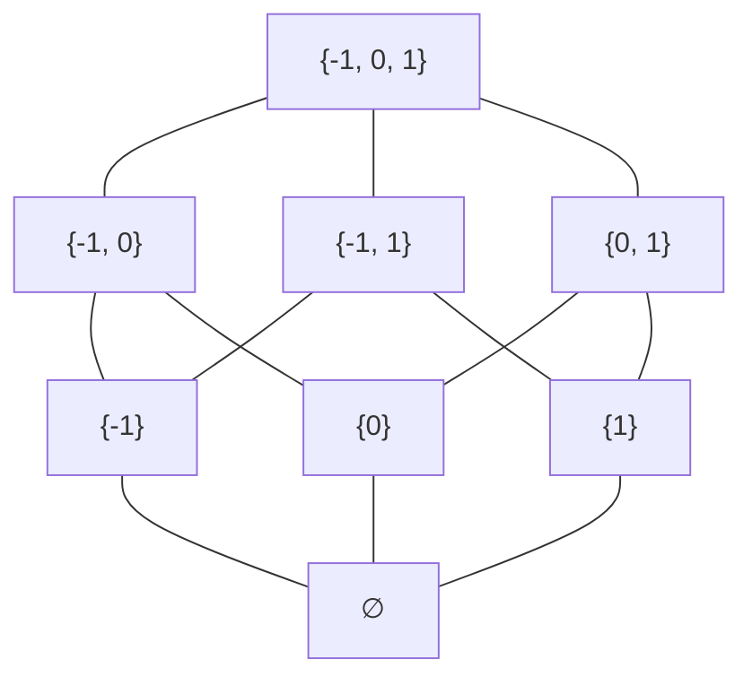
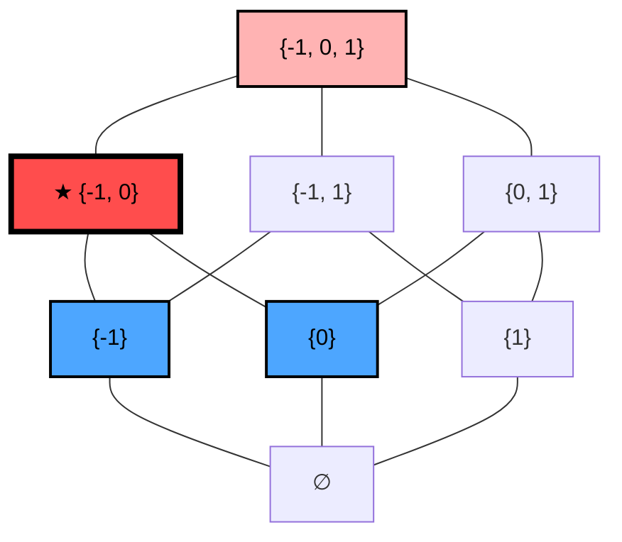
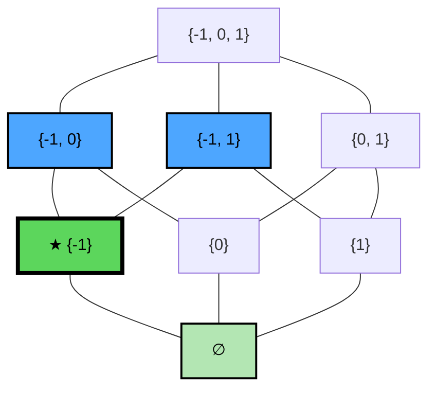

**Date:** September 24, 2026

## 1. Set Theory Refresher

> [!info] Set Theory Definitions
> - **Set:**          $S$
> - **Element:**      $s \in S$
> - **Subset:**       $S_1 \subseteq S_2 \triangleq \forall s \in S_1 \implies s \in S_2$
> - **Union:**        $S_1 \cup S_2 \triangleq \{s \mid s \in S_1 \lor s \in S_2\}$
> - **Intersection:** $S_1 \cap S_2 \triangleq \{s \mid s \in S_1 \land s \in S_2\}$

---

## 2. Partially Ordered Sets (Posets)

> [!info] Partial Order (Poset)
> A partial order $\sqsubseteq$ on a set $X$ forms a **Poset** $\langle X, \sqsubseteq \rangle$ if it satisfies:
> - **Reflexive:** $\forall x \in X, x \sqsubseteq x$
> - **Anti-symmetric:** $\forall x, y \in X, (x \sqsubseteq y \land y \sqsubseteq x) \implies x = y$
> - **Transitive:** $\forall x, y, z \in X, (x \sqsubseteq y \land y \sqsubseteq z) \implies x \sqsubseteq z$

> [!example] Powerset $\mathcal{P}(X)$
> Given a set $X$, $\mathcal{P}(X)$ is the set of all subsets of $X$.
> - $\mathcal{P}(\emptyset) = \{\emptyset\}$
> - $\mathcal{P}(\{0, 1\}) = \{\emptyset, \{0\}, \{1\}, \{0, 1\}\}$

> [!note] Powerset as a Poset
> The powerset $\mathcal{P}(S)$ forms a poset under subset inclusion $\subseteq$:
> - **Reflexive:** $\forall X \in \mathcal{P}(S), X \subseteq X$
> - **Anti-symmetric:** $\forall X, Y \in \mathcal{P}(S), (X \subseteq Y \land Y \subseteq X) \implies X = Y$
> - **Transitive:** $\forall X, Y, Z \in \mathcal{P}(S), (X \subseteq Y \land Y \subseteq Z) \implies X \subseteq Z$

> [!example] Common Poset Examples
> - $\langle \mathcal{P}(S), \subseteq \rangle$ (generalizing $\langle X, \sqsubseteq \rangle$)
> - $\langle \mathcal{P}(S), \supseteq \rangle$ (generalizing $\langle X, \sqsupseteq \rangle$)
> - $\langle \mathbb{N}, \le \rangle$ and $\langle \mathbb{Z}, \le \rangle$

---

## 3. Hasse Diagrams

Given $\langle X, \sqsubseteq \rangle$ where $X = \{-1, 0, 1\}$, the powerset is:
$\mathcal{P}(X) = \{\emptyset, \{-1\}, \{0\}, \{1\}, \{-1, 0\}, \{-1, 1\}, \{0, 1\}, \{-1, 0, 1\}\}$

In a Hasse diagram, a line connects $x$ and $y$ if and only if ($y$ covers $x$):
- $x \sqsubset y$ ($x$ is strictly less than $y$)
- $\nexists z \in X \mid x \sqsubset z \sqsubset y$ (there is no intermediate element $z$)

---

## 4. Bounds and Extrema

### 4.1 Upper Bounds and LUB

*(The elements of $S = \{\{-1\}, \{0\}\}$ are highlighted in blue. The Upper Bounds are highlighted in red).*

> [!info] Upper Bound
> Given a poset $\langle X, \sqsubseteq \rangle$ and a subset $S \subseteq X$:
> - An element $s \in X$ is an **upper bound** of $S$ if $\forall s' \in S, s \sqsupseteq s'$

> [!info] Least Upper Bound (LUB)
> Given a poset $\langle X, \sqsubseteq \rangle$ and a subset $S \subseteq X$, let $UB(S)$ be the set of all upper bounds of $S$.
> An element $s \in X$ is the **Least Upper Bound (LUB)** of $S$ if:
> 1. $s \in UB(S)$ (i.e., $s$ is an upper bound of $S$)
> 2. $\forall s' \in UB(S), s \sqsubseteq s'$ (i.e., $s$ is the smallest among all upper bounds)

> [!example] Static Analysis Application: Merging States
> In static program analysis, when control flow merges after an `if-else` statement, the resulting memory state is the **Least Upper Bound (LUB)** of the states from both branches. 
> 
> | Code | State of `x` |
> |---|---|
> | `int a[10];` | |
> | `if (*) {` | |
> | &nbsp;&nbsp;&nbsp;&nbsp;`x = 5;` | $x \to \{5\}$ |
> | `} else {` | |
> | &nbsp;&nbsp;&nbsp;&nbsp;`x = 7;` | $x \to \{7\}$ |
> | `}` | |
> | `a[x];` | $x \to \{5, 7\}$ |

### 4.2 Lower Bounds and GLB

*(The elements of $S = \{\{-1, 0\}, \{-1, 1\}\}$ are highlighted in blue. The GLB is $\{-1\}$, highlighted in green).*

> [!info] Lower Bound
> Given a poset $\langle X, \sqsubseteq \rangle$ and a subset $S \subseteq X$:
> - An element $s \in X$ is a **lower bound** of $S$ if $\forall s' \in S, s \sqsubseteq s'$

> [!info] Greatest Lower Bound (GLB)
> Given a poset $\langle X, \sqsubseteq \rangle$ and a subset $S \subseteq X$, let $LB(S)$ be the set of all lower bounds of $S$.
> An element $s \in X$ is the **Greatest Lower Bound (GLB)** of $S$ if:
> 1. $s \in LB(S)$ (i.e., $s$ is a lower bound of $S$)
> 2. $\forall s' \in LB(S), s' \sqsubseteq s$ (i.e., $s$ is the greatest among all lower bounds)

### 4.3 TOP and BOTTOM

> [!info] TOP and BOTTOM
> Given a subset $S \subseteq X$:
> - **TOP (==top==):** If the LUB of $S$ belongs to $S$ itself, then it is the **TOP (==top==)** of $S$.
> - **BOTTOM (==bottom==):** If the GLB of $S$ belongs to $S$ itself, then it is the **BOTTOM (==bottom==)** of $S$.

---

## 5. Lattices

> [!info] Join ($\sqcup$) and Meet ($\sqcap$) Operators
> In a poset $\langle X, \sqsubseteq \rangle$, specific symbols denote the LUB and GLB:
> - **Join (LUB):** $\sqcup$ (e.g., $\sqcup S$)
> - **Meet (GLB):** $\sqcap$ (e.g., $\sqcap S$)
> 
> Formally, these apply to subsets (e.g., $\sqcup \{a, b\}$). However, it is common to use them as **binary operators**:
> - $a \sqcup b \triangleq \sqcup \{a, b\}$ (the LUB between $a$ and $b$)
> - $a \sqcap b \triangleq \sqcap \{a, b\}$ (the GLB between $a$ and $b$)
>
> **Properties:**
> - **Uniqueness:** If the LUB ($\sqcup$) or GLB ($\sqcap$) of a subset exists, it is **unique**.
> - **Global Bounds:** The LUB of the entire set $X$ is denoted as $\top$ ($\sqcup X = \top$), and the GLB is denoted as $\bot$ ($\sqcap X = \bot$).

> [!info] Semilattices
> A poset $\langle X, \sqsubseteq \rangle$ can be classified based on the existence of joins and meets:
> - **Join Semilattice:** For every pair $x, y \in X$, the join $x \sqcup y$ exists.
> - **Meet Semilattice:** For every pair $x, y \in X$, the meet $x \sqcap y$ exists.

> [!info] Lattice (Refined Definition)
> A **Lattice** is a poset that is *both* a Join Semilattice and a Meet Semilattice.
> 
> **Example:** The powerset $\langle \mathcal{P}(S), \subseteq \rangle$ forms a lattice where:
> - $X \sqcup Y = X \cup Y$
> - $X \sqcap Y = X \cap Y$

> [!warning] Finiteness in Lattices
> The definition of a lattice strictly requires LUB and GLB to exist for **pairs** of elements (and by induction, any finite subset). It does **not** guarantee the existence of LUB/GLB for *infinite* subsets.
> 
> **Counterexample (Regular Languages):**
> Consider the poset of all Regular Languages $\langle \mathcal{L}_{reg}, \subseteq \rangle$. This forms a lattice with $L_1 \sqcup L_2 = L_1 \cup L_2$ and $L_1 \sqcap L_2 = L_1 \cap L_2$.
> - Let $L_i = \{a^i b^i\}$. For any specific $i$, $L_i$ is finite and therefore regular.
> - However, the infinite union (LUB) of all such languages is $\bigcup_{i=0}^{\infty} L_i = \{a^n b^n \mid n \ge 0\}$.
> - $\{a^n b^n\}$ is a context-free language, **not** a regular language. Thus, the LUB of the infinite subset $\{L_i\}$ does not exist within $\mathcal{L}_{reg}$.
