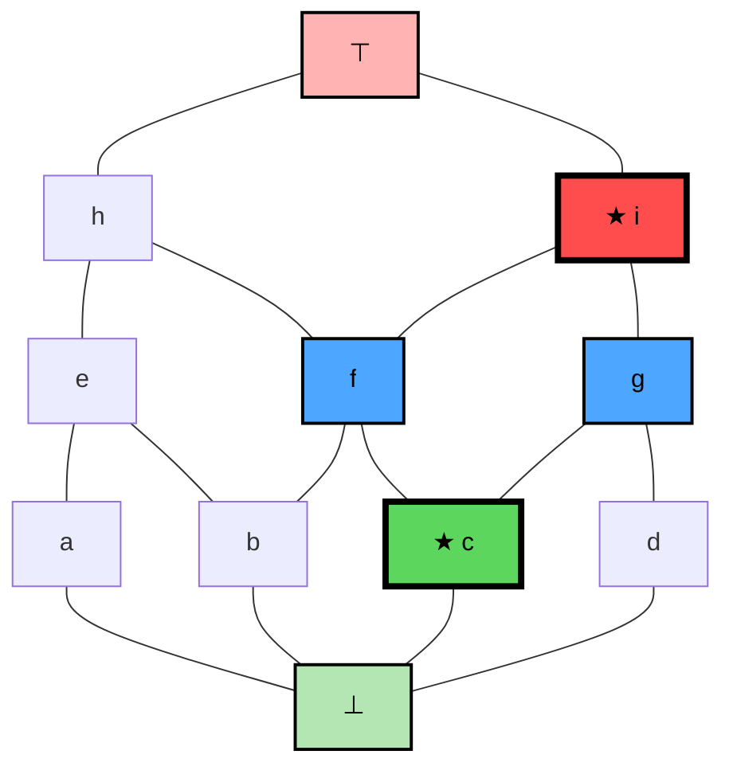
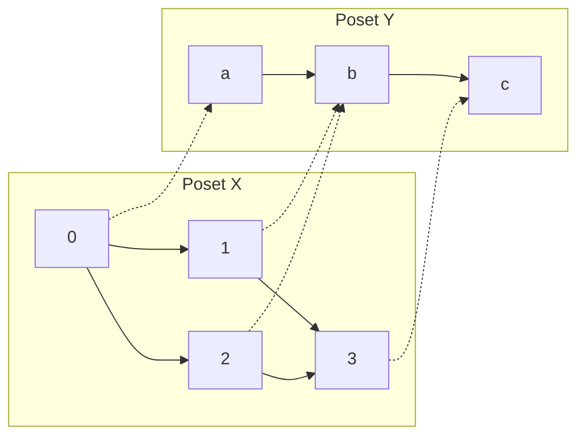
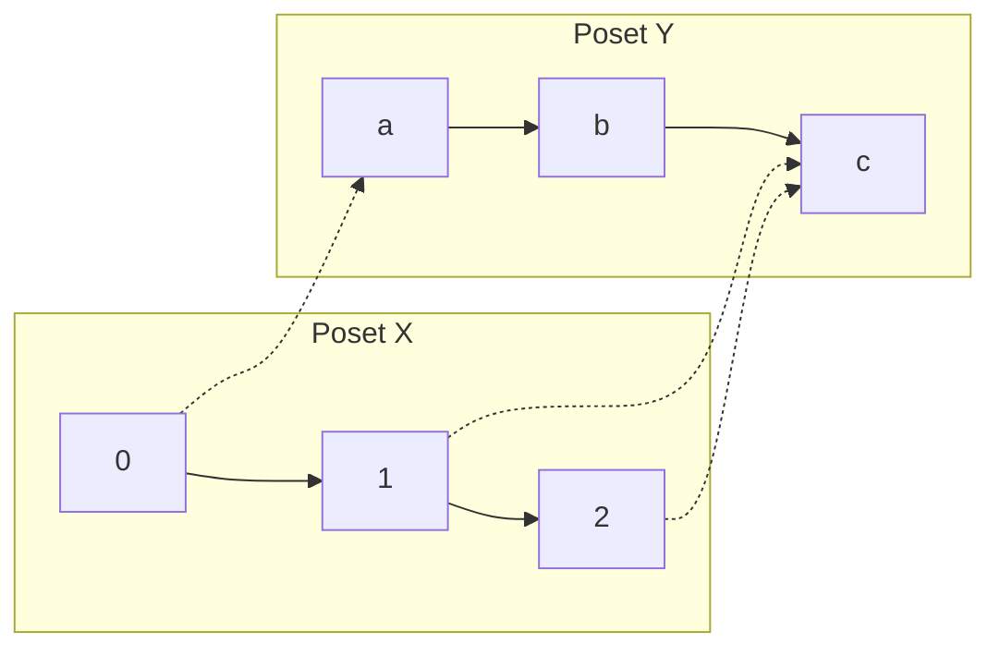
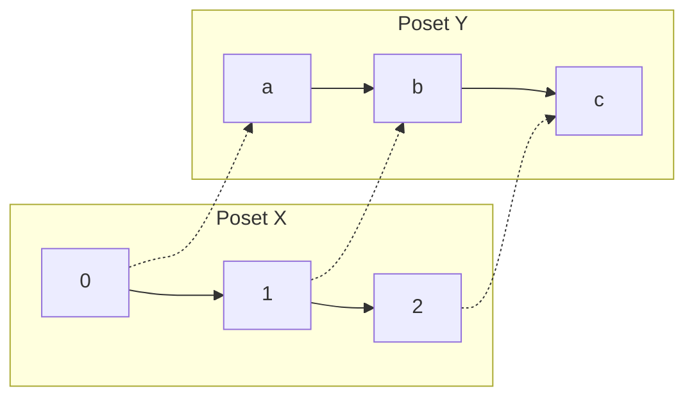

**Date:** September 25, 2026

## 1. Complete Lattices

> [!info] Complete Lattice Definition & Notation
> A lattice $\langle X, \sqsubseteq, \sqcup, \sqcap \rangle$ is a **Complete Lattice** if every subset $S \subseteq X$ has a Least Upper Bound (LUB) in $X$.
> 
> *Note:* This guarantees the lattice is bounded (it has a bottom element $\bot$, which is the LUB of the empty set $\emptyset$, and a top element $\top$, which is the LUB of $X$).
> 
> **Notation:** A complete lattice is often explicitly denoted as a 6-tuple: $\langle X, \sqsubseteq, \sqcup, \sqcap, \top, \bot \rangle$
> 
> **Examples:**
> - **Incomplete Lattice:** The set of integers $\langle \mathbb{Z}, \le, \max, \min \rangle$ is a poset and a lattice, but it is **not complete** (it lacks top/bottom elements, and infinite subsets have no LUB).
> - **Complete Lattice:** The extended integers $\langle \mathbb{Z} \cup \{-\infty, +\infty\}, \le, \max, \min \rangle$ form a **complete lattice**. Every subset is bounded and has both a LUB and a GLB.
> - **Powerset Lattice:** The powerset poset $\langle \mathcal{P}(X), \subseteq, \cup, \cap \rangle$ is a complete lattice with $\top = X$ and $\bot = \emptyset$.

> [!info] Duality of LUB and GLB
> In a complete lattice, the existence of all Least Upper Bounds (LUB) guarantees the existence of all Greatest Lower Bounds (GLB), and vice versa:
> - **GLB from LUB:** $\sqcap S = \sqcup \{y \in X \mid \forall x \in S, y \sqsubseteq x\}$ 
>   *(The GLB of $S$ is the LUB of the set of all lower bounds of $S$)*
> - **LUB from GLB:** $\sqcup S = \sqcap \{y \in X \mid \forall x \in S, x \sqsubseteq y\}$ 
>   *(The LUB of $S$ is the GLB of the set of all upper bounds of $S$)*

### 1.1 Complete Lattice Hasse Diagram Example

*(The elements of $S = \{c, f, g\}$ are highlighted in blue. The LUB $i$ is red with a star, and the GLB $c$ is green with a star).*

> [!example] Calculating LUB and GLB for $S = \{c, f, g\}$
> Applying the duality formulas to the highlighted set $S$ in the diagram above:
> 
> **1. Least Upper Bound ($\sqcup S$):**
> - The **upper bounds** of $S$ (elements $\ge c$, $f$, and $g$) are $\{i, \top\}$.
> - Therefore, the LUB is the GLB of its upper bounds: $\sqcup S = \sqcap \{i, \top\} = i$.
> 
> **2. Greatest Lower Bound ($\sqcap S$):**
> - The **lower bounds** of $S$ (elements $\le c$, $f$, and $g$) are $\{\bot, c\}$.
> - Therefore, the GLB is the LUB of its lower bounds: $\sqcap S = \sqcup \{\bot, c\} = c$.

---

## 2. Relations and Functions

> [!info] Relations, Partial Orders, and Functions
> - **Cartesian Product:** $X \times Y = \{(x, y) \mid x \in X, y \in Y\}$
> - **Relation:** $R \subseteq X \times Y$ (written as $x \mathrel{R} y$). Note that a partial order $\sqsubseteq$ is a specific type of relation over $X \times X$.
> - **Function:** A relation $R \subseteq X \times Y$ that maps each input to at most one output (right-uniqueness). For every $(x, y) \in R$, there is no $(x, y') \in R$ where $y \neq y'$.

> [!info] Function Notation and Mappings
> Given a function $f \subseteq X \times Y$:
> - It is standard to write **$f: X \to Y$** ($X$ is the Domain, $Y$ is the Codomain).
> - Since a function is a relation, $(x, y) \in f$ simply means $f(x) = y$.
> 
> **Explicit Mapping Notation:**
> $f = [x_0 \mapsto y_0, x_1 \mapsto y_1, \dots, x_n \mapsto y_n]$
> 
> **Lambda Notation:**
> Functions can also be expressed using $\lambda x.\, f(x)$, denoting an anonymous function that takes an argument $x$ and returns $f(x)$ (functionally equivalent to $f$ itself via $\eta$-reduction).

> [!example] Memory States as Functions (Variables $\to$ Intervals)
> In program analysis, memory states are modeled as functions mapping variables to values (e.g., $m: \text{Var} \to \text{Intervals}$).
> For example, an initial state: $m_5 = [x \mapsto [0, 1], y \mapsto [5, 9]]$
> 
> **Function Update Notation ($f[x_n \mapsto y_n]$):**
> If an assignment occurs (`x = 9`), we update the function to a new state $m_6$:
> $$m_6 = m_5[x \mapsto [9, 9]] = [x \mapsto [9, 9], y \mapsto [5, 9]]$$
> Formally:
> $$f[x_n \mapsto y_n](x_j) = \begin{cases} y_n & \text{if } x_j = x_n \\ f(x_j) & \text{otherwise} \end{cases}$$
> 
> **Step-by-Step Chained Updates:**
> Evaluating $(\{x \mapsto 5\}[x \mapsto 9][y \mapsto 3][z \mapsto 13])(x)$:
> 1. $f_0 = \{x \mapsto 5\}$
> 2. Apply $[x \mapsto 9]$: $f_1 = \{x \mapsto 9\}$ (overwrites 5)
> 3. Apply $[y \mapsto 3]$: $f_2 = \{x \mapsto 9, y \mapsto 3\}$
> 4. Apply $[z \mapsto 13]$: $f_3 = \{x \mapsto 9, y \mapsto 3, z \mapsto 13\}$
> Result: $f_3(x) = 9$

---

## 3. Order-Preserving Functions

> [!info] Monotone, Order-Embedding, and Isomorphism
> Given posets $\langle X, \sqsubseteq_X \rangle$ and $\langle Y, \sqsubseteq_Y \rangle$, and $f: X \to Y$:
> 1. **Monotone (Order-Preserving):** $x_1 \sqsubseteq_X x_2 \implies f(x_1) \sqsubseteq_Y f(x_2)$
> 2. **Order-Embedding:** $x_1 \sqsubseteq_X x_2 \iff f(x_1) \sqsubseteq_Y f(x_2)$ (reflects order in both directions)
> 3. **Order Isomorphism:** $f$ is an order-embedding AND is surjective ($\forall y \in Y, \exists x \in X \text{ s.t. } f(x) = y$).
> 
> **Join/Meet Preserving:**
> - **Join-Preserving:** $f(x_1 \sqcup_X x_2) = f(x_1) \sqcup_Y f(x_2)$
> - **Meet-Preserving:** $f(x_1 \sqcap_X x_2) = f(x_1) \sqcap_Y f(x_2)$

### 3.1 Function Examples

**1. Monotone, but NOT an Order-Embedding**
Preserves order, but doesn't reflect it backwards (squashes uncomparable elements). Mapping: $f(0)=a, f(1)=b, f(2)=b, f(3)=c$

**2. Monotone, but NOT an Order-Embedding (Counterexample)**
Fails order-embedding because $f(1) \sqsubseteq_Y f(2)$ holds ($c \sqsubseteq c$), but $1 \sqsubseteq_X 2$ is true and $2 \sqsubseteq_X 1$ is false.

**3. Order Isomorphism**
Perfectly reflects the order and is surjective. The posets are structurally identical.

---

## 4. Chains and ACC

> [!info] Chains and Ascending Chain Condition (ACC)
> - **Chain (Totally Ordered Set):** A subset $S \subseteq X$ where every pair of elements is comparable ($x \sqsubseteq y$ or $y \sqsubseteq x$).
> - **Ascending Chain:** A sequence where $l_0 \sqsubseteq l_1 \sqsubseteq l_2 \sqsubseteq \dots$
> 
> **Ascending Chain Condition (ACC):**
> A poset satisfies the ACC if every infinite ascending chain is eventually constant (stabilizes).
> $\forall \text{ ascending chain } (l_n), \exists k \ge 0 \text{ s.t. } \forall j \ge k, l_k = l_j$

> [!example] ACC Examples
> - **Finite Posets:** Any finite poset automatically satisfies the ACC.
> - **Powerset Lattices:** $\langle \mathcal{P}(X), \subseteq \rangle$ satisfies the ACC if and only if $X$ is a finite set.
> - **Integers $\mathbb{Z}$:** $\langle \mathbb{Z}, \le \rangle$ **does not** satisfy the ACC ($1 \le 2 \le 3 \dots$).
> - **Naturals $\mathbb{N}$:** $\langle \mathbb{N}, \le \rangle$ **does not** satisfy the ACC.
> - **Naturals (Reverse Order):** $\langle \mathbb{N}, \ge \rangle$ **does** satisfy the ACC. (Any *infinite* ascending chain corresponds to decreasing numbers $l_0 \ge l_1 \dots$, which cannot strictly decrease infinitely below $0$. It must eventually stabilize).

---

## 5. Continuous Maps

> [!info] Continuous Maps
> Given two posets (or lattices) $\langle X, \sqsubseteq_X \rangle$ and $\langle Y, \sqsubseteq_Y \rangle$, a function $f: X \to Y$ is **continuous** if, for every chain $C \subseteq X$ where the LUB $\sqcup_X C$ exists, the following hold:
> 
> 1. The LUB of the mapped chain exists in $Y$: $\sqcup_Y f(C)$ exists.
> 2. The function preserves the LUB of the chain:
>    $$\sqcup_Y f(C) = f(\sqcup_X C)$$

### 5.1 Continuous vs. Non-Continuous Examples

To understand continuity, consider the poset $\langle \mathcal{P}(\mathbb{N}), \subseteq \rangle$ (the powerset of natural numbers). 
Let $C$ be an infinite ascending chain of finite sets: 
$C = \{ \{0\}, \{0, 1\}, \{0, 1, 2\}, \dots \}$
The LUB of this chain is the set of all natural numbers: $\sqcup C = \mathbb{N}$.

> [!example] A Continuous Function
> Let $f(X) = X \cup \{42\}$. 
> - **Applying $f$ to the LUB:** $f(\sqcup C) = f(\mathbb{N}) = \mathbb{N} \cup \{42\} = \mathbb{N}$.
> - **LUB of the mapped chain:** First we map each element: $f(\{0\}) = \{0, 42\}$, $f(\{0, 1\}) = \{0, 1, 42\}$, etc. The LUB of these results is $\bigcup (C_i \cup \{42\}) = \mathbb{N} \cup \{42\} = \mathbb{N}$.
> 
> Since $f(\sqcup C) = \sqcup f(C)$, the function is **continuous**.

> [!example] A Non-Continuous Function
> Let $g(X)$ be a function that behaves differently for finite and infinite sets:
> $$g(X) = \begin{cases} X & \text{if } X \text{ is finite} \\ \emptyset & \text{if } X \text{ is infinite} \end{cases}$$
> 
> - **LUB of the mapped chain:** Every element $C_i$ in the chain is finite, so $g(C_i) = C_i$. The LUB of this mapped chain is $\sqcup g(C) = \bigcup C_i = \mathbb{N}$.
> - **Applying $g$ to the LUB:** The LUB of the chain is $\mathbb{N}$ (which is infinite). So, $g(\sqcup C) = g(\mathbb{N}) = \emptyset$.
> 
> Since $\mathbb{N} \neq \emptyset$ (i.e., $\sqcup g(C) \neq g(\sqcup C)$), the function $g$ **fails to preserve the LUB** of the chain and is therefore **NOT continuous**.

