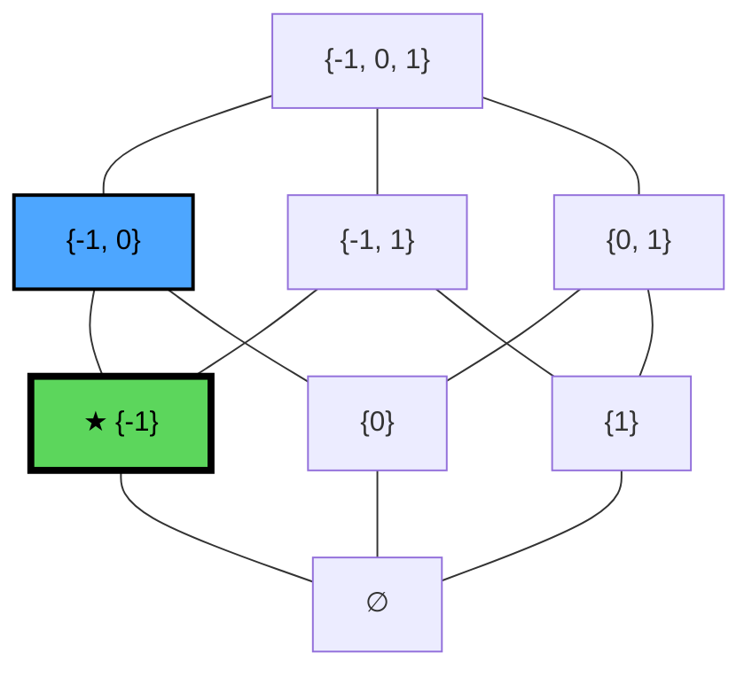
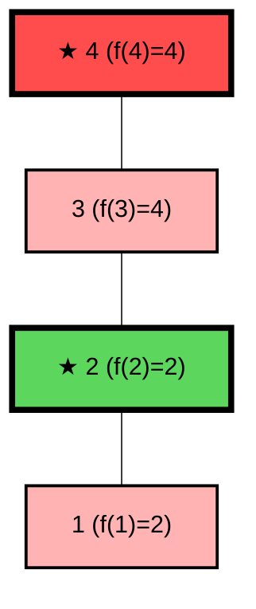

**Date:** September 30, 2026

## 1. Fixpoints

> [!info] Fixpoints
> Given a poset and a function $f: X \to X$:
> - An element $x \in X$ is a **fixpoint** if $f(x) = x$.
> - The set of all fixpoints of $f$ is denoted as $Fix(f) = \{x \in X \mid f(x) = x\}$.
> 
> **Least Fixpoint (lfp)**
> An element $x \in Fix(f)$ is the **least fixpoint (lfp)** if for every $y \in Fix(f)$, $x \sqsubseteq y$. 
> 
> **Greatest Fixpoint (gfp)**
> An element $x \in Fix(f)$ is the **greatest fixpoint (gfp)** if for every $y \in Fix(f)$, $x \sqsupseteq y$.
> 
> *(Note: If the lfp or gfp exists, it is **unique**).*

---

## 2. Powerset Hasse Diagram and Fixpoints Example

> [!example] Function on a Powerset
> Consider the function $f: \mathcal{P}(\{-1, 0, 1\}) \to \mathcal{P}(\{-1, 0, 1\})$ defined as:
> $$f(X) = \begin{cases} X \setminus \{1\} & \text{if } 1 \in X \\ X \cup \{-1\} & \text{otherwise} \end{cases}$$
> 
> The fixpoints of this function are the sets where $f(X) = X$.
> In this case, the fixpoints are **$\{-1, 0\}$** and **$\{-1\}$**. 
> - **Least Fixpoint (lfp):** $\{-1\}$

Hasse diagram for the poset $\langle \mathcal{P}(\{-1, 0, 1\}), \subseteq \rangle$:
*(Fixpoints are highlighted in blue. The least fixpoint (lfp) is marked with a star).*


---

## 3. Function Iterations

> [!info] Iterations
> Let $f: X \to X$. The **iterates** of an element $x \in X$ are defined recursively as:
> - $f^0(x) = x$
> - $f^{n+1}(x) = f(f^n(x))$

## 4. Knaster-Tarski Fixpoint Theorem

> [!info] Knaster-Tarski Theorem
> Let $\langle X, \sqsubseteq, \sqcup, \sqcap \rangle$ be a **complete lattice** and let $f: X \to X$ be a **monotone** function. 
> 
> The theorem states that the set of all fixpoints of $f$, $\langle Fix(f), \sqsubseteq, \sqcup, \sqcap \rangle$, is itself a **complete lattice**.
> 
> This guarantees that $f$ has at least one fixpoint, and specifically, it has a **Least Fixpoint (lfp)** and a **Greatest Fixpoint (gfp)**, defined as:
> 
> - $lfp(f) = \sqcap \{x \in X \mid f(x) \sqsubseteq x\}$ (The GLB of all **pre-fixpoints**)
> - $gfp(f) = \sqcup \{x \in X \mid x \sqsubseteq f(x)\}$ (The LUB of all **post-fixpoints**)

> [!example] Pre-fixpoints vs Post-fixpoints Explained
> - **Pre-fixpoint:** An element $x$ where applying the function makes it "smaller" or keeps it the same ($f(x) \sqsubseteq x$).
> - **Post-fixpoint:** An element $x$ where applying the function makes it "larger" or keeps it the same ($x \sqsubseteq f(x)$).
> 
> By taking the GLB of all elements that shrink or stay the same (pre-fixpoints), we converge on the absolute "bottom" fixpoint (lfp). Similarly, taking the LUB of all post-fixpoints yields the highest fixpoint (gfp).

### 4.1 Powerset Example (Non-Monotone Function)

Let's revisit the powerset function from Section 2: $f(X) = X \setminus \{1\}$ if $1 \in X$, else $X \cup \{-1\}$.
This function is **not monotone**. For example, $\{0\} \subseteq \{0, 1\}$, but $f(\{0\}) = \{-1, 0\}$ which is not a subset of $f(\{0, 1\}) = \{0\}$.
Because it is not monotone, the Knaster-Tarski theorem **does not apply**, which we can demonstrate by finding the pre/post-fixpoints:

- **Pre-fixpoints ($f(X) \subseteq X$):** $\{-1\}, \{1\}, \{-1, 0\}, \{-1, 1\}, \{0, 1\}, \{-1, 0, 1\}$
- **GLB of Pre-fixpoints:** $\bigcap = \emptyset$

Notice that the GLB of all pre-fixpoints is $\emptyset$. However, $\emptyset$ is **not** a fixpoint ($f(\emptyset) = \{-1\}$)! The actual Least Fixpoint is $\{-1\}$. This perfectly illustrates why monotonicity is a strict requirement for Knaster-Tarski.

### 4.2 Knaster-Tarski Visual Example (Monotone)

Consider a simple total order complete lattice $X = \{1, 2, 3, 4\}$ with $1 \sqsubseteq 2 \sqsubseteq 3 \sqsubseteq 4$.
Let $f$ be a monotone function defined as:
- $f(1) = 2$  (post-fixpoint: $1 \sqsubseteq 2$)
- $f(2) = 2$  (**fixpoint**)
- $f(3) = 4$  (post-fixpoint: $3 \sqsubseteq 4$)
- $f(4) = 4$  (**fixpoint**)



- **Fixpoints:** $\{2, 4\}$
- $lfp(f) = 2$
- $gfp(f) = 4$

---

## 5. Kleene Fixpoint Theorem

> [!info] Kleene Fixpoint Theorem
> Let $\langle X, \sqsubseteq, \sqcup, \sqcap, \top, \bot \rangle$ be a complete lattice and let $f: X \to X$ be a **continuous** function.
> 
> The theorem states that $f$ has a **Least Fixpoint (lfp)**, and it can be iteratively computed as the LUB of the ascending chain formed by repeatedly applying $f$ to the BOTTOM element ($\bot$):
> 
> $$lfp(f) = \bigsqcup_{n \ge 0} f^n(\bot)$$
> 
> **The Iteration Chain:**
> The sequence of iterations forms an ascending chain:
> $$\bot \sqsubseteq f(\bot) \sqsubseteq f^2(\bot) \sqsubseteq f^3(\bot) \sqsubseteq \dots$$
> Because $f$ is continuous, applying $f$ to the LUB of this chain yields the exact same LUB, proving it has stabilized as a fixpoint.


---

## 6. Slide Examples (Block 3)
*(Note: Notes here are manually written for now; we'll integrate directly from the slides later).*

```c
1  i = read();
2  if (i != 0)
3      j = 5 / i;
4  else
5      j = 0;
6  return;
```
*Goal: certify that the program is safe w.r.t. division by zero*

> [!example] Trace Analysis and LUB Calculation
> Analyzing the possible values for variables `i` and `j` at each line of the program:
> 
> | Line | Possible Values for `i` | Possible Values for `j` |
> | :---: | :--- | :--- |
> | **0** | $\emptyset$ | $\emptyset$ |
> | **1** | $\mathbb{Z}$ | $\emptyset$ |
> | **2** | $\mathbb{Z}$ | $\emptyset$ |
> | **3** | $\mathbb{Z} \setminus \{0\}$ | $\{-5, -2, -1, 0, 1, 2, 5\}$ |
> | **4** | $\{0\}$ | $\{0\}$ |
> 
> **Least Upper Bound (LUB) Computation:**
> To find the abstract state representing all possible values, we compute the LUB ($\sqcup$) for each variable by taking the union of the sets across all lines:
> - **LUB for `i`:** $\emptyset \cup \mathbb{Z} \cup \mathbb{Z} \cup (\mathbb{Z} \setminus \{0\}) \cup \{0\} = \mathbb{Z}$
> - **LUB for `j`:** $\emptyset \cup \emptyset \cup \emptyset \cup \{-5, -2, -1, 0, 1, 2, 5\} \cup \{0\} = \{-5, -2, -1, 0, 1, 2, 5\}$

### 6.1 Least Upper Bound in Static Analysis

> [!example] Abstract State and Intervals
> Consider the following program where $i$ is assigned a set of values:
> 
> ```c
> 1  i = {-1, 0, 1}
> 2  if (i != 0)
> 3      j = 5 / i;
> 4  else
> 5      j = 0;
> 6  return;
> ```
> 
> In static analysis, the **'abstract state'** is modeled as a function mapping variables to abstract values (like intervals). 
> 
> **Trace Table (Interval Analysis):**
> 
> | Program point | Values |
> | :---: | :--- |
> | **1** | `i = {}` |
> | **2** | `i = [-1, 1]` |
> | **3** | `i = [-1, 1]` |
> | **5** | `i = [0, 0]` |
> | **6** | `i = [-1, 1]`, `j = [-5, 5]` |
> 
> At program point **6** (the join point), the abstract state merges the paths.
> We compute the **LUB** for `j` based on the branches:
> - from line 3: `j = [-5, 5]` *(computed as 5 / [-1, 1] excluding 0)*
> - from line 5: `j = [0, 0]`
> 
> The resulting LUB at line 6 encompasses all possible outcomes: `j = [-5, 5]`.

### 6.2 Filtering and Unreachability

> [!example] Branch Filtering (Reachable Path)
> ```c
> 1  i = read();
> 2  if (i >= 5)
> 3      i = i + 1;
> ```
> - **At point 2 (before condition):** The abstract state is $i = \mathbb{Z}$.
> - **Entering the true branch (point 3):** We filter the state: 
>   $i = \mathbb{Z} \cap \text{filter}(i \ge 5) = \{5, 6, 7, \dots\}$

> [!example] Branch Filtering (Unreachable Path)
> ```c
> 1  i = {-1, 0, 1};
> 2  if (i >= 5)
> 3      i = i + 1;
> ```
> - **At point 2 (before condition):** The abstract state is $i = \{-1, 0, 1\}$.
> - **Entering the true branch (point 3):** We filter the state:
>   $i = \{-1, 0, 1\} \cap \text{filter}(i \ge 5) = \emptyset$
> 
> Because the intersection yields the empty set ($\emptyset$), the abstract semantics correctly deduce that **program point 3 is completely unreachable**.

### 6.3 Computing Fixpoints via Iteration

> [!example] Fixpoint Iteration on a `while` Loop
> Consider the lattice $\langle \mathcal{P}(\mathbb{Z}), \subseteq, \cup, \cap \rangle$ and the following program:
> 
> ```c
> 1  i = 0;
> 2  while (?)
> 3      i++;
> 4  ...
> ```
> 
> We can define the abstract states at each program point using recursive equations:
> - **Line 1:** $\emptyset$
> - **Line 2:** $\{0\} \cup \text{eval}(i\text{++ at line 3})$
> - **Line 3:** State at line 2
> - **Line 4:** State at line 2
> 
> **Iterative Computation Table:**
> 
> | Program point | Iteration 0 | Iteration 1 | Iteration 2 | Iteration 3 | Iteration 4 |
> | :---: | :---: | :---: | :---: | :---: | :---: |
> | **1** | $\emptyset$ | $\emptyset$ | $\emptyset$ | $\emptyset$ | $\emptyset$ |
> | **2** | $\emptyset$ | $\{0\}$ | $\{0\}$ | $\{0, 1\}$ | $\{0, 1\}$ |
> | **3** | $\emptyset$ | $\emptyset$ | $\{0\}$ | $\{0\}$ | $\{0, 1\}$ |
> | **4** | $\emptyset$ | $\emptyset$ | $\{0\}$ | $\{0\}$ | $\{0, 1\}$ |
> 
> *By the Kleene Fixpoint Theorem, the fixpoint exists (since the lattice is complete and the transfer functions are continuous). However, because the ascending chain is infinite ($\{0\} \subseteq \{0, 1\} \subseteq \{0, 1, 2\} \dots$), we cannot fully compute it in finite time this way.*

### 6.4 Computable Fixpoints with Abstract Lattices

> [!example] Fixpoint Iteration (Sign Lattice)
> To solve the non-termination issue from the previous example, we can use a simpler abstract lattice that guarantees convergence. Consider the Sign Lattice:
> $\langle \{0, +, -, \bot, \top \}, \sqsubseteq, \sqcup, \sqcap, \top, \bot \rangle$
> 
> ```c
> 1  i = 0;
> 2  while (?)
> 3      i++;
> 4  ...
> ```
> 
> The recursive equations for the abstract states:
> - **Line 1:** $\bot$ (BOTTOM)
> - **Line 2:** $0 \sqcup \text{eval}(i\text{++ at line 3})$
> - **Line 3:** State at line 2
> - **Line 4:** State at line 2
> 
> **Iterative Computation Table:**
> 
> | Program point | Iteration 0 | Iteration 1 | ... | Iteration 4 | Iteration 5 |
> | :---: | :---: | :---: | :---: | :---: | :---: |
> | **1** | BOTTOM | ... | ... | BOTTOM | BOTTOM |
> | **2** | BOTTOM | ... | ... | TOP | TOP |
> | **3** | BOTTOM | ... | ... | TOP | TOP |
> | **4** | BOTTOM | ... | ... | TOP | TOP |
> 
> Because the Sign Lattice is finite (it has a finite height), the LUB sequence must stabilize. At **Iteration 5**, the state matches Iteration 4 exactly, meaning we have successfully computed the **Fixpoint!**
